<div align="center">

# Depotcharge

**Book the bay. The truck does the rest.**

Open-source charging-slot booking for electric HGV fleets, built on the OCPI open standard.
No RFID cards. No payment terminals. No driver app.

[](LICENSE)
[](https://evroaming.org/ocpi/)
[](https://github.com/craig-weston/EV-Charging-booking-reservation-OCPI-app/actions/workflows/ci.yml)

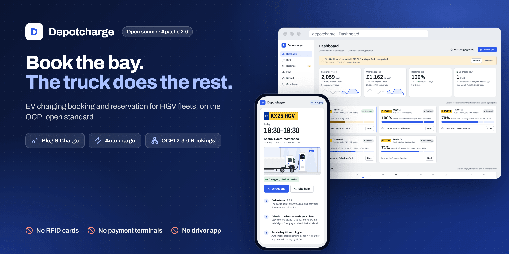

</div>

---

Electric trucks need to charge away from home: at another fleet's depot, a logistics park, a
motorway hub. Today that means phone calls to reserve a bay, a wallet of RFID cards, and drivers
queuing at payment terminals.

**Depotcharge replaces all of it.** Planners book a bay at any operator that speaks OCPI. When the
truck arrives, the barrier opens for its number plate, and the charger recognises the truck
itself, by **Plug & Charge** or **Autocharge**, and starts charging. The driver just parks and
plugs in.

## Why fleets choose it

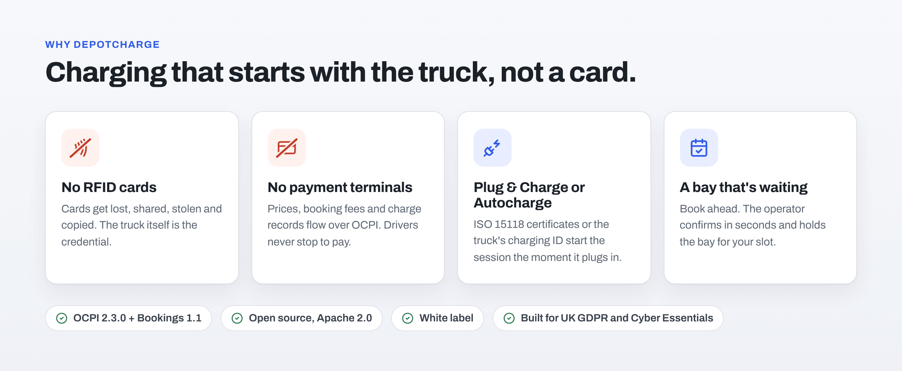

### No more RFID cards

Charge cards get left in the wrong cab, passed between drivers, lost and stolen. Many carry only
a fixed ID that can be copied. Depotcharge doesn't use them at all. The truck is the credential:

- **Plug & Charge (ISO 15118)**: the truck and charger authenticate each other with digital
  certificates. Nothing to carry, nothing to copy.
- **Autocharge**: the charger recognises the truck's charging ID as it plugs in.

Either way, each session is authorised in real time against the fleet's booking, and owners
decide whether trucks may charge without one at all.

### No payment terminals

Prices, booking fees and charge records flow between fleet and operator over OCPI. Drivers never
stop to pay, and depot bays don't need card readers to take bookings from other fleets.

### Bookings, not luck

Reserve the bay before the truck sets off. The operator confirms in seconds, holds the bay for the
slot, and both sides see the same booking, changes and cancellation terms. If plans change, change
the booking: the operator updates its calendar instantly.

### Open, and yours

- **Open standard:** OCPI 2.3.0 with the Bookings module 1.1, so any operator can join. No lock-in.
- **Open source:** Apache 2.0. Run it as your fleet portal, build it into your TMS or telematics
  platform, or offer it to your customers.
- **White label:** your name, logo and colour across every screen and driver pass, in seconds.

## How it works

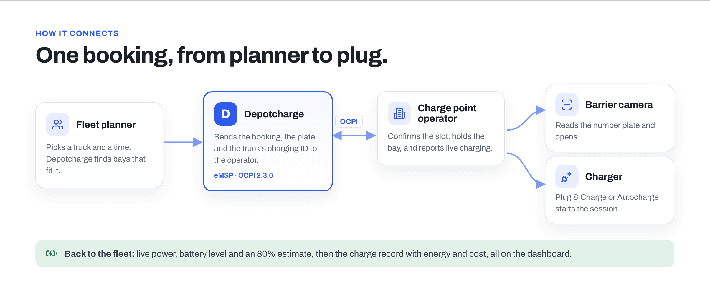

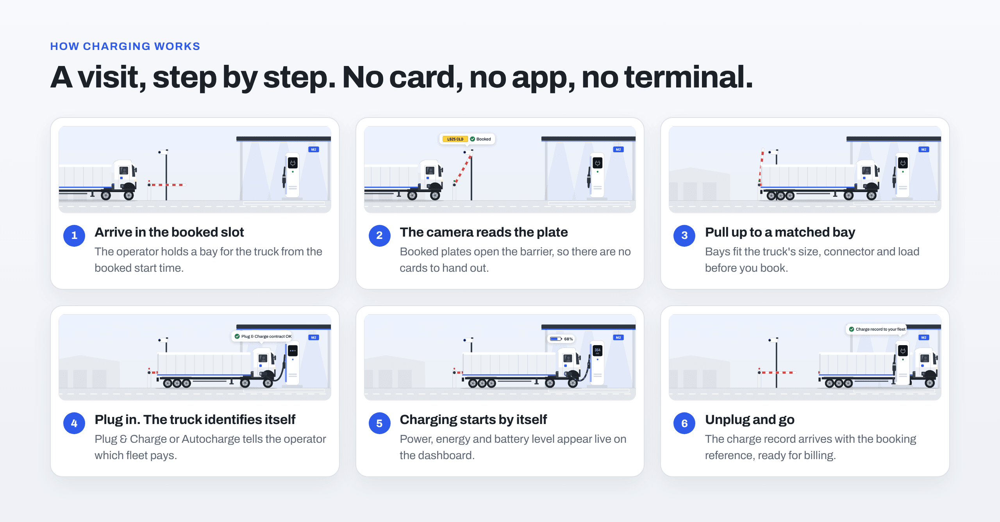

### In the app

<table>
<tr>
<td width="50%" valign="top">

**1. Find a bay**

Pick a truck and a time. Depotcharge matches it to compatible bays (connector, power, length,
height, dangerous goods, reefer power) at every connected operator, with live availability and
prices.

</td>
<td width="50%" valign="top">

**2. Book it**

The request goes to the operator over OCPI Bookings and is confirmed in seconds. The driver gets a
pass by text or WhatsApp: address, arrival window, and exactly what happens at the gate.

</td>
</tr>
<tr>
<td>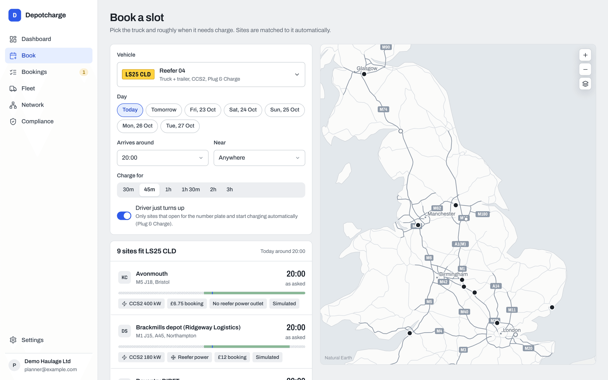</td>
<td align="center">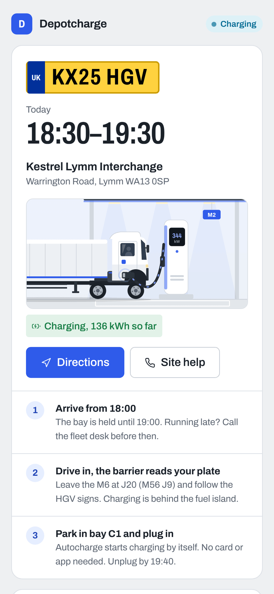</td>
</tr>
<tr>
<td width="50%" valign="top">

**3. Drive in, plug in**

The barrier opens for the number plate. The charger recognises the truck by Plug & Charge or
Autocharge and starts on its own. No card, no app, no terminal.

</td>
<td width="50%" valign="top">

**4. Watch it charge**

Live power and battery level on the dashboard, an estimate of when the truck reaches 80%, and the
final charge record with energy and cost, all from the operator's OCPI data.

</td>
</tr>
<tr>
<td>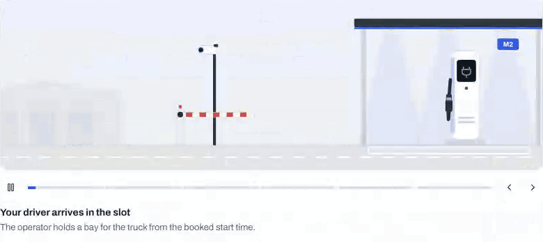</td>
<td>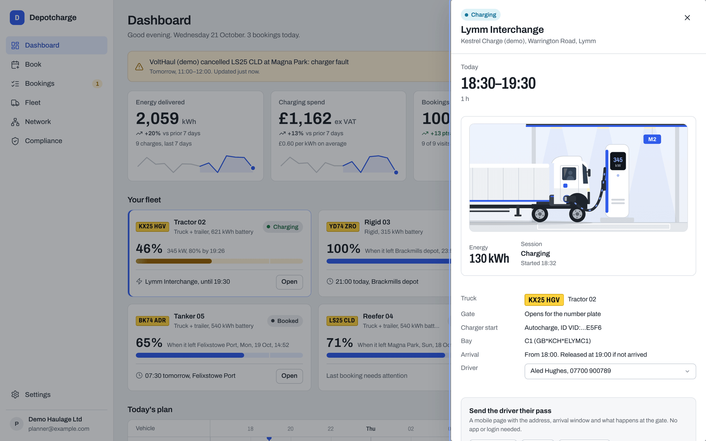</td>
</tr>
</table>

## Everything a fleet needs

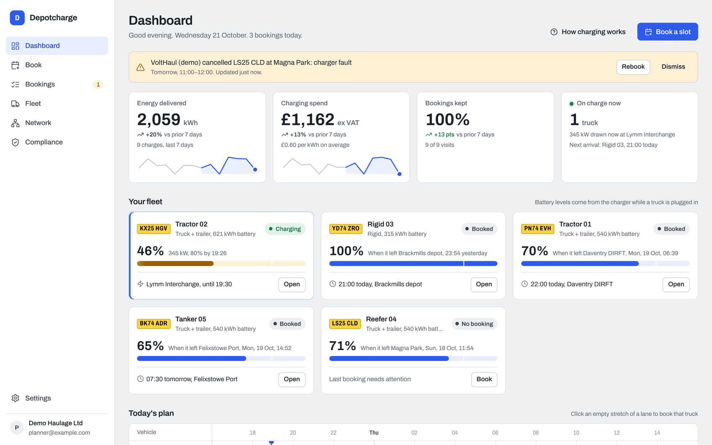

- **Dashboard:** energy, spend and price per kWh, bookings kept, trucks on charge, and every
  truck's battery level, live or as it left its last charge.
- **Planning:** a lane board of the day for every truck; drag a gap to book it.
- **Bookings:** confirmations, changes, cancellations with reasons, no-shows, and the operator's
  terms in plain English.
- **Driver messages:** the pass link by text or WhatsApp, sent automatically when a booking is
  confirmed, changed or cancelled (via Twilio, per fleet), or shared by the planner.
- **Fleet:** trucks with their charging capabilities and IDs, drivers, and sample trucks to start
  with.
- **Team:** owners, planners and viewers, single-use invites, and an activity log.
- **API keys:** your TMS, telematics, dispatch or autonomous vehicle platform can find bays and book
  them without anyone signing in. Keys are per fleet, read-only or booking, revocable and audited
  ([API guide](docs/api.md)).
- **Animated guides:** a step-by-step simulation of each visit, shown to planners and on every
  driver pass.

## Built for operators and software providers

Depotcharge is a complete **eMSP** (e-mobility service provider) over **OCPI 2.3.0**:

| Module | Depotcharge's role | What it does |
| --- | --- | --- |
| Bookings 1.1 | Receiver | Booking locations and calendars; create, change and cancel booking requests; bookings pushed back |
| Locations, Tariffs | Receiver | Sites, bays, connectors, prices and booking fees |
| Sessions, CDRs | Receiver | Live energy, power and battery level; the final charge record linked to the booking |
| Tokens | Sender | Plug & Charge contracts and Autocharge IDs, with real-time authorisation |
| Credentials | Both | The standard handshake, either direction |

<table>
<tr>
<td width="50%">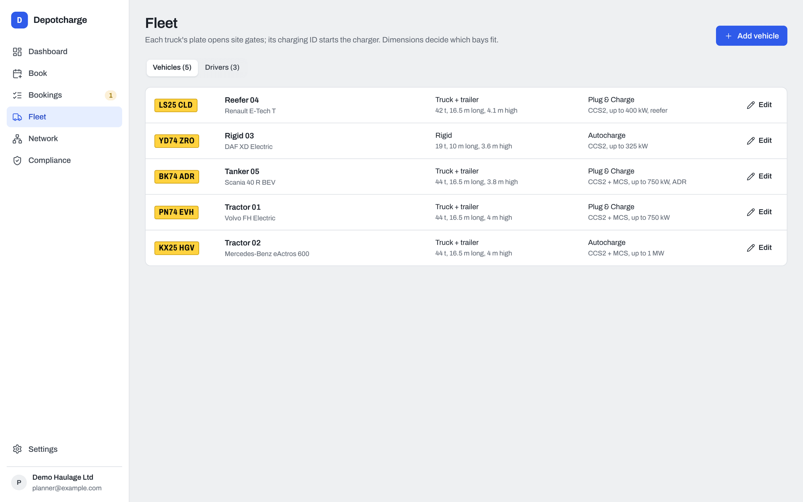</td>
<td width="50%">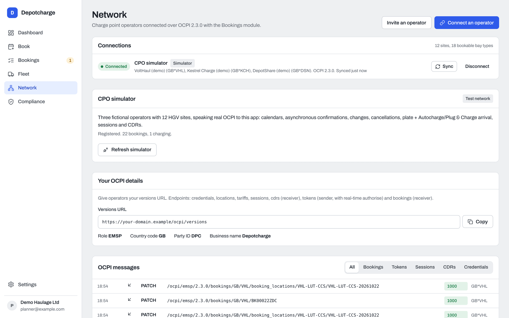</td>
</tr>
<tr>
<td>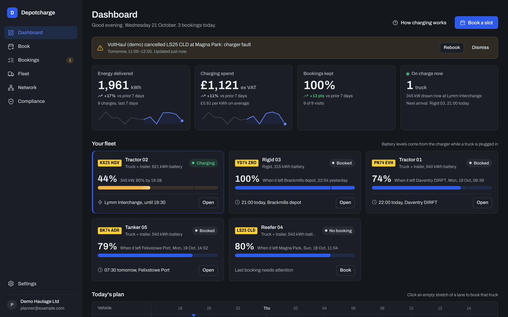</td>
<td align="center">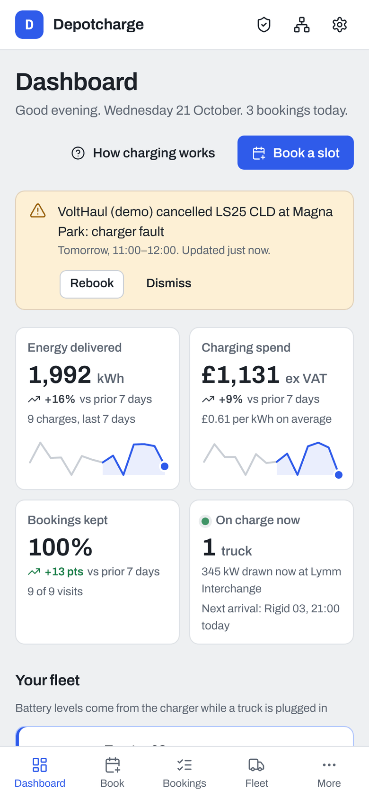</td>
</tr>
</table>

A built-in **operator simulator** (three fictional operators, 12 UK sites) answers over real OCPI,
so you can test end to end before connecting a real network. Every message in and out is logged.

## Secure by design

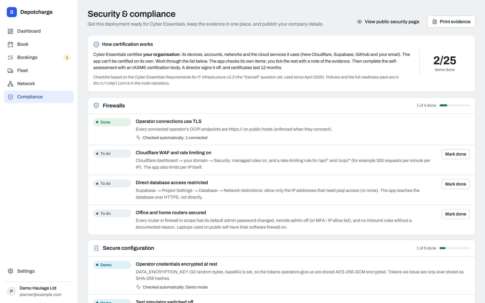

- **Two-step verification** with an authenticator app: required for admins, optional for whole fleets.
- **Strict Content-Security-Policy**, no third-party scripts or fonts, rate limits and input
  validation on every request.
- **Operator credentials encrypted** at rest or stored only as hashes, never in logs.
- **Fleets isolated** in the API and again by database row level security.
- **UK GDPR tools built in:** data export, deletion, automatic retention, an audit log, and legal
  page templates.
- **Cyber Essentials readiness:** a checklist that checks your deployment against the UK scheme's
  controls, plus policies and an incident response plan in [docs/compliance](docs/compliance/README.md).

## Try it in two minutes

```bash
git clone https://github.com/craig-weston/EV-Charging-booking-reservation-OCPI-app.git
cd EV-Charging-booking-reservation-OCPI-app
npm install
npm run dev
```

Open http://localhost:5173. Demo mode runs the whole stack in your browser (the API, the OCPI
interface and the simulated operators), with a fleet and two weeks of charging history.

## Set up your own


Depotcharge runs on **Cloudflare Workers** and **Supabase**; both free tiers are enough to start.

1. **Supabase:** create a project (UK or EU region), enable the **pg_cron** extension, then run
   each file in [`supabase/migrations`](supabase/migrations), oldest first, in the SQL editor. Under Authentication, set a 12-character minimum password and keep TOTP enabled.
2. **Cloudflare:** fork this repository, then in Workers & Pages choose **Create → Import a
   repository** (or open an existing Worker → Settings → Builds → Connect). Build command
   `npm install`, deploy command `npx wrangler deploy`. Every push to `main` deploys.
3. **Add your keys** under the Worker's **Settings → Variables and Secrets**: `SUPABASE_URL`
   (text), and as secrets `SUPABASE_ANON_KEY` (publishable key), `SUPABASE_SERVICE_ROLE_KEY`
   (secret key) and `DATA_ENCRYPTION_KEY` (from `openssl rand -base64 32`). Add
   `ENABLE_CPO_SIMULATOR=true` to try the simulated operators.
4. **Point Supabase at your site:** Authentication → URL Configuration, Site URL
   `https://<your-worker>.workers.dev` and redirect URL `https://<your-worker>.workers.dev/**`.
5. **Sign in and book:** create an account and your fleet, make yourself a platform admin (one SQL
   line in the guide), then connect an operator or the simulator under **Network**.

Every option, the OCPI operator onboarding and the production checklist:
**[docs/deploy.md](docs/deploy.md)**.

## Contributing

Fleets, operators and developers are all welcome: bug reports, operator integration reports,
features and docs. See [CONTRIBUTING.md](CONTRIBUTING.md). Report security issues privately as
described in [SECURITY.md](SECURITY.md).

## Licence

[Apache License 2.0](LICENSE). See [NOTICE](NOTICE) for third-party components. OCPI is published
by the EVRoaming Foundation; Depotcharge implements it and isn't affiliated with or endorsed by
the foundation.
