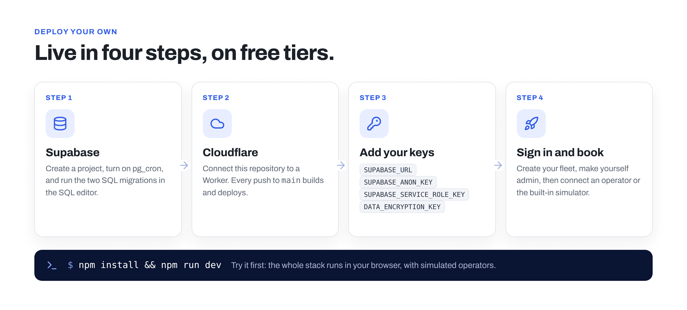

# Running and deploying Depotcharge



Depotcharge runs on **Cloudflare** (a Worker serving the web app and the API) and **Supabase**
(Postgres and sign-in). Both have free tiers that are enough to try it with a real operator.

- [Run it locally](#run-it-locally)
- [Deploy](#deploy): [Supabase](#1-supabase), [Cloudflare Workers](#2-cloudflare-workers), [first sign-in](#3-first-sign-in)
- [Connecting a real operator](#connecting-a-real-operator-cpo)
- [White label](#white-label) · [Project layout](#project-layout) · [Operating notes](#operating-notes)

## Run it locally

Node 22 or newer (`.nvmrc`).

```bash
npm install            # first time: commit the package-lock.json it creates
npm run dev            # demo mode on http://localhost:5173 (in-browser API + simulator)
npm test               # OCPI flows, team invites, booking logic, security controls (node --test)
npm run typecheck
npm run build          # production build into dist/
npm run build:preview  # one self-contained demo file: dist-preview/index.html
```

To run the real Worker locally against your Supabase project:

```bash
cp .dev.vars.example .dev.vars   # fill in your keys
npx wrangler dev                 # builds, then serves on http://localhost:8787
```

## Deploy

### 1. Supabase

1. Create a project (pick a UK or EU region).
2. **Database → Extensions**: enable **pg_cron** (schedules the daily data-retention job).
3. **SQL Editor → New query**: run every file in `supabase/migrations`, oldest first:
   `20261020000000_init.sql` (schema and row level security), `20261021000000_security.sql`
   (hashed operator tokens, audit log, read-only browser access, the retention job), then the later
   ones (for example `20261027000000_api_keys.sql`). With the Supabase CLI instead:
   `supabase link` then `supabase db push`. When you update, run any new migration the same way.
4. **Authentication → Sign In / Providers → Email**: keep "Confirm email" on (invite links survive
   the confirmation step), turn on **Secure password change**, set **Minimum password length to
   12**, and turn on **leaked password protection** if your plan has it.
5. **Authentication → Multi-Factor**: make sure **TOTP (App Authenticator)** is enabled.
6. **Authentication → URL Configuration**: set the Site URL to your app's address (for example
   `https://depotcharge.<your-subdomain>.workers.dev`) and add the same address followed by `/**`
   to the redirect URLs.
7. **Project Settings → API Keys**: you'll need the **Project URL**, the **publishable** key and
   the **secret** key.
8. For production: custom SMTP (Authentication → Emails) with SPF, DKIM and DMARC, and
   **Network restrictions** so nothing can connect to Postgres directly.

### 2. Cloudflare Workers

`wrangler.jsonc` describes the Worker: `worker/index.ts` handles `/api/*`, `/ocpi/*` and `/sim/*`;
everything else is the static app from `dist/`, with the security headers in `public/_headers`.

**Deploy from GitHub (recommended).** Workers & Pages → your Worker (or Create → Import a
repository) → **Settings → Builds → Connect** and pick this repository:

- Build command: `npm install` (or `npm ci` once `package-lock.json` is committed)
- Deploy command: `npx wrangler deploy` (it runs `npm run build` first)
- Build variables (optional): `SUPABASE_URL` (puts your exact Supabase origin into the
  Content-Security-Policy) and `SECURITY_CONTACT` (generates `/.well-known/security.txt`)

Every push to `main` then deploys. **Or deploy from your computer:** `npx wrangler login`, then
`npx wrangler deploy`.

Then **Settings → Variables and Secrets**:

| Name | Type | Value | Notes |
| --- | --- | --- | --- |
| `SUPABASE_URL` | Text | `https://<ref>.supabase.co` | |
| `SUPABASE_ANON_KEY` | Secret | publishable key | Sent to browsers for sign-in. |
| `SUPABASE_SERVICE_ROLE_KEY` | Secret | secret key | Server only. |
| `DATA_ENCRYPTION_KEY` | Secret | output of `openssl rand -base64 32` | Encrypts the credentials operators give you (AES-256-GCM). Keep a copy in your password manager. |
| `OCPI_COUNTRY_CODE` | Text | `GB` | Your eMSP country code. |
| `OCPI_PARTY_ID` | Text | e.g. `DPC` | Your 3-character party ID. |
| `OCPI_BUSINESS_NAME` | Text | `Depotcharge` | Shown to operators. |
| `ENABLE_CPO_SIMULATOR` | Text | `true` | Test network. Remove it before going live. |
| `PUBLIC_BASE_URL` | Text | `https://book.example.com` | Optional: set once you use a custom domain. |
| `SECURITY_CONTACT` | Text | `security@example.com` | Shown on the Security page. |
| `DATA_ENCRYPTION_KEY_PREVIOUS` | Secret | | Only while rotating the key (see the security policy). |
| `TWILIO_ACCOUNT_SID` | Text | `AC…` | Optional: automatic driver texts / WhatsApp (see below). |
| `TWILIO_AUTH_TOKEN` | Secret | | Server only. |
| `TWILIO_FROM` | Text | `+447700900000` or a sender ID | SMS sender. Set it to offer text messages. |
| `TWILIO_WHATSAPP_FROM` | Text | `+447700900000` | WhatsApp-enabled sender. Set it to offer WhatsApp. |
| `REQUIRE_ADMIN_MFA` | Text | | Leave unset: platform admins must use two-step verification. |
| `LEGAL_*`, `BRAND_*` | Text | | Optional defaults for Compliance → Company & legal and Settings → Branding. |

Until the `SUPABASE_*` values are set, the site runs in demo mode.

**Automatic driver messages.** With the Twilio values set, fleet owners can choose **Settings →
Fleet → Message drivers automatically** (text or WhatsApp). The assigned driver then gets their
pass link when a booking is confirmed, a new one if the time, driver or link changes, and a
"don't go" message if it is cancelled. Each result (sent, or why it failed) appears on the
booking's timeline, with the number masked. Notes:

- Use a UK number or a registered alphanumeric sender ID for SMS; drivers' numbers are
  normalised to +44 when they start with 0.
- WhatsApp only delivers free-form messages inside a 24-hour window after the driver last wrote
  to you. For messages that start the conversation, Meta requires an approved template; until
  you have one, offer SMS.
- Twilio becomes a sub-processor: it is already listed in the data processing terms (Annex C)
  and `docs/compliance/data-protection.md`. Tell fleet owners before you switch it on.

Also recommended in Cloudflare: SSL/TLS **Full (strict)**, minimum TLS 1.2, Always Use HTTPS, WAF
managed rules, and a rate-limiting rule for `/api/*` and `/ocpi/*` (on a custom domain).

**Cloudflare Pages instead?** It works too: connect the repo to a Pages project with build command
`npm run build` and output directory `dist` (the `functions/` folder serves the API). For a
dashboard drag-and-drop upload, run `npm run build:upload` and upload `dist-upload/`.

### 3. First sign-in

1. Open the site, **Create an account**, confirm the email, then **Set up your fleet** (tick
   "Add five sample trucks" to try booking straight away).
2. Make yourself a platform admin (gives you Network, the OCPI message log, Compliance and
   Branding). Admin pages ask you to set up two-step verification first. In the Supabase SQL
   editor:

   ```sql
   insert into public.platform_admins (user_id)
   select id from auth.users where email = 'you@example.com';
   ```

3. With `ENABLE_CPO_SIMULATOR=true`: **Network → Connect simulator**, then **Book**. Open a
   booking and use **Simulate at the site** (truck arrives, finish charging, no-show, operator
   cancels) to watch the OCPI messages, the live session and the charge record arrive.
4. Invite colleagues from **Settings → Team**. Roles are Owner, Planner and Viewer.
5. Fill in **Compliance → Company & legal** so the legal pages show your company details, and
   work through the Cyber Essentials checklist there.

## Connecting a real operator (CPO)

Your OCPI versions URL is `https://<your-domain>/ocpi/versions` (also shown under **Network →
Your OCPI details**).

- **They register with you:** Network → **Invite an operator** creates a registration token
  (token A). Send them the versions URL and token; they `POST /credentials` and the connection
  appears.
- **You register with them:** Network → **Connect an operator** with their versions URL and the
  token A they gave you. Depotcharge runs the credentials handshake, then pulls Locations, Tariffs
  and BookingLocations.

What the operator needs to support:

| Module | Their role | Used for |
| --- | --- | --- |
| Bookings 1.1 | SENDER (we are RECEIVER) | BookingLocations and calendars, BookingRequests (create, change, cancel), Booking updates pushed back |
| Locations, Tariffs | SENDER | Sites, bays, connectors, booking fees (Tariff `booking` restrictions) |
| Sessions, CDRs | SENDER | Live energy and battery level, and the final charge record (`booking_id` links it to the booking) |
| Tokens | RECEIVER (we are SENDER) | Token list plus real-time authorisation: `POST /tokens/{uid}/authorize` answers `ALLOWED` with the booking's `authorization_reference` |

The plate is sent as `access_information` `LICENSE_PLATE` (normalised, e.g. `PN74EVH`). Plug &
Charge trucks are sent as token type `EMAID` (contract ID); Autocharge trucks as type `OTHER` with
the vehicle ID (e.g. `VID:A4B2C3D4E5F6`).

### Notes on the OCPI implementation

- **Autocharge** isn't in OCPI 2.3.0's `ConnectorCapability` list. Depotcharge reads a custom
  `AUTOCHARGE` value (OCPI enums are open) to know a connector can start Autocharge trucks without
  driver action; ask operators to publish it, or such sites show as "driver action needed".
- The Bookings document calls the module both `bookings` and `Booking`; Depotcharge publishes
  both endpoint identifiers and accepts either from operators.
- A Booking pushed by the operator can overtake the synchronous `POST` response; stale or
  out-of-order Booking objects are ignored (`last_updated` wins, a final status never goes back).
- Changes and cancellations reuse the original `request_id` (cancellation sets `canceled`), as
  the module requires. Bookings are looked up by `request_id` or the operator's booking `id`.
- `power_required` in a BookingRequest is kW; Timeslot `min_power` / `max_power` are W.
- Battery level comes from the `STATE_OF_CHARGE` and `POWER` dimensions of the Session's charging
  periods.
- Every OCPI message in and out is logged (Network → OCPI messages), with credentials redacted.

## White label

- **Settings → Branding** (platform admins): product name, logo (SVG/PNG upload or https URL),
  brand colour, support email and phone, and an optional "Powered by" line on driver passes. One
  colour drives every accent, the illustrations and the favicon monogram; text contrast is
  computed so any colour stays readable, in light and dark themes.
- `BRAND_*` variables set the defaults used before anything is saved.
- Static favicon: `public/favicon.svg`. Typeface: Archivo, self-hosted from `src/assets/fonts`
  (`--font` in `src/styles/app.css`).

## Project layout

```
worker/               Cloudflare Workers entry (wrangler.jsonc) → server/live.ts
functions/            Cloudflare Pages Functions (alternative to the Worker)
server/
  api/                JSON API for the web app (fleets, team, vehicles, bookings, admin, compliance)
  ocpi/               OCPI 2.3.0 eMSP: versions, credentials, bookings receiver, locations,
                      tariffs, sessions, CDRs, tokens (+ real-time authorise), HTTP client, registration
  emsp/               Booking service: create, change, cancel, reconcile, link sessions and CDRs
  sim/                CPO simulator (fictional operators, sites, calendars, sessions, CDRs)
  store/              Supabase (PostgREST over fetch) and in-memory stores
shared/               OCPI types, booking logic (compatibility, slots, terms, tariffs), model
src/                  React web app (pages, components, legal pages, illustrations in components/art)
supabase/migrations/  Schema, row level security, security hardening and retention
docs/compliance/      Cyber Essentials readiness, policies, incident response, data protection records
tests/                node --test suites; tests/sql has a plain-Postgres RLS check
```

RLS check without Supabase (any Postgres 15+):

```bash
createdb depotcharge_test
cd tests/sql
psql -d depotcharge_test -f supabase_stub.sql -f ../../supabase/migrations/20261020000000_init.sql \
  -f ../../supabase/migrations/20261021000000_security.sql -f rls_check.sql
```

## Operating notes

- The Worker uses the Supabase secret key and enforces fleet membership in code; row level
  security is defence in depth for anything that reads Supabase directly with a user session.
- Live updates use polling (every 4 s while something is pending, 20 s otherwise).
- The simulator does more work per request than the eMSP itself (it builds 7 days of calendars).
  If you see "exceeded CPU" errors on Cloudflare's free plan, move to Workers Paid or turn the
  simulator off. Real operators don't run inside your project.
- Times are stored in UTC and shown in the site's time zone (Europe/London for UK sites).
